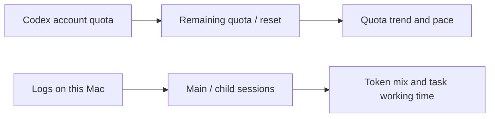

<h1>Donvis</h1>

<strong>See your remaining Codex quota and understand what your agents are doing.</strong>

Check quota in the menu bar. Explore sessions, child agents, and token usage in the desktop workspace. Know what is left before you start, and where the work went when you finish.

  <a href="https://github.com/sherlockmen/Donvis/releases/download/v3.2.18/Donvis-3.2.18-macOS-arm64.dmg"><strong>Download for Apple Silicon</strong></a>
  &nbsp;·&nbsp;
  <a href="https://github.com/sherlockmen/Donvis/releases/download/v3.2.18/Donvis-3.2.18-macOS-x86_64.dmg"><strong>Download for Intel</strong></a>

v3.2.18 · macOS 13+ · <a href="https://github.com/sherlockmen/Donvis/releases/tag/v3.2.18">Release notes and checksums</a>

<a href="README.md">简体中文</a> · <strong>English</strong>

> Captured from the running macOS app using real local records. Identifying details are redacted; usage values are unchanged and reflect the time of capture. Account resources depend on what the service returns.

[Get started](#get-started) · [Feature tour](#feature-tour) · [Data and privacy](#data-and-privacy) · [FAQ](#faq)

## Before, during, and after the task

- **Before you start, check the allowance:** See remaining quota, reset times, and the last update. Clients signed in to the same account share one allowance.
- **While agents work, follow the split:** Inspect main sessions and child agents, including models, reasoning effort, tools, recognized `SKILL.md` reads, and token usage.
- **After the task, review the usage:** Filter local records by date, model, project, or session. Separate input, output, and cache reads, then export JSON or CSV.
- **Across a busy day, watch the pace:** Compare quota history, recent consumption, and the reset window to plan the next stretch of work.
- **Over time, see the working pattern:** Explore the working-time calendar and performance recorded in local logs, with main-session usage distinct from child-agent totals.

The support guidance and examples in this release focus on **Codex**. Other service integrations are still being tuned and are not recommended as supported features in this release.

## Get started

1. **Install Donvis.** Download the DMG for your Mac’s chip, open it, and drag `Donvis.app` into Applications.
2. **Sign in to Codex Desktop or Codex CLI.** Install and sign in to either client before starting Donvis. The connected-tools view also shows detection of Codex Desktop, Codex CLI, and the official VS Code extension; quota access depends on the Desktop or CLI setup.
3. **Start with the overview.** Check quota from the menu bar and open the main window for detailed statistics. Adjust low-quota alerts, display preferences, and global shortcuts in Settings.

**First launch:** This release uses an ad-hoc signature and has not been notarized by Apple. If macOS blocks it, go to **System Settings → Privacy & Security** and choose **Open Anyway** for Donvis. Do this only after checking where you downloaded the installer.

**First connection:** Quota needs a working Codex sign-in and network access. Local statistics need time to scan existing logs. Empty, incomplete, and older readings have their own indicators; they do not mean zero usage. Donvis displays the quota windows the account supplies, rather than filling in a fixed “5-hour / 7-day” pair.

## Feature tour

### A quota check within reach

Keep the workspace out of the way while you code. Click the menu-bar icon to see quota, the reset countdown, and data freshness, or switch between remaining and used quota. Low-quota alerts use thresholds you can adjust in Settings and require system notification permission.

Open the main window from the menu bar or Dock when you want the full picture. Closing the window keeps Donvis running in the menu bar; quitting stops monitoring and alerts.

### Follow the main session and its child agents

[View the full still image](assets/v3.2.18/codex-sessions.png)

A task split across several agents needs more context than one token total. Donvis separates the main session from its child agents. Choose a time range, inspect models, clients, tools, and recognized `SKILL.md` reads, then expand a session for the details. Skill entries reflect those recognized reads, not a complete record of skill execution.

- See the model and reasoning effort associated with a session’s work.
- Separate uncached input, cache reads, cache writes, and output. Reasoning tokens are part of output and are not added a second time.
- Distinguish the main session’s own usage from child-agent totals, keeping shared and derived records in context.

The Codex view also brings together recent main-session context usage, the working-time calendar, and performance from local logs. Elapsed time can include tool execution and waiting, so these records help explain your work rather than rank model speed.

Working time uses task-running intervals recognized in the logs. It merges overlapping intervals across parallel main sessions, measuring recorded task runtime rather than a person’s hours worked.

### Put the remaining quota in context

“40% left” and “how long it might last at this pace” answer different questions. The history view places recorded samples, recent consumption, estimated remaining time, and the next reset together, helping you decide whether to keep the current schedule or adjust it.

History comes from samples already recorded. Limited samples, a window reset, or a gap in the record can restrict forecasts. Model and reasoning-effort comparisons also need enough completed tasks. Work on other devices, task difficulty, and cache hits can all change the actual outcome.

When the account supplies them, resource cards show balances, credits, reset-card counts, and expiry dates. The reset action opens the official page; confirming that you used a card marks local history. Donvis does not redeem reset cards automatically.

### Go from the total to the session

Explore which project used the most today, which model read more cached tokens, and which sessions account for the larger share. Date filters, the activity calendar, session details, and exports let you review the same slice of local work.

**Cost display is optional.** Enter model prices to set your API reference rates, then enable cost estimates when you want to show them in the workspace. Records without a price remain unpriced. These estimates are separate from a Codex subscription bill or an actual charge.

JSON and CSV exports make further analysis possible. They contain statistics such as project names, models, anonymous session identifiers, and token counts. Saved valid prices can also produce `estimatedUSD` values in exports even when cost display is off. Check the contents before sharing them.

## Data and privacy

Total tokens cannot be directly converted into a subscription quota percentage. Quota and local statistics follow different paths:

Different views use different sources. Use these boundaries to decide which features you want enabled:

| Information | Source and scope |
| --- | --- |
| Account quota, reset times, and account resources | Read through Codex app-server using the existing sign-in. Refreshing makes network requests; available fields depend on what the account returns. |
| Tokens, models, projects, and session statistics | Built from logs on this Mac, not account-wide usage across every device. Missing records, an unfinished scan, or format changes affect coverage. |
| Session details and performance | Some details read local session titles or opening prompts to identify the task. |
| API reference costs | Calculated using model prices you save. Workspace visibility and export calculations are separate: saved valid prices can produce `estimatedUSD` even with cost display off. These estimates are not provider invoices and do not create charges. |
| JSON and CSV exports | Statistical exports omit conversation bodies, account identifiers, and secrets, but include work information such as project names and any calculated cost estimates. |
| LAN snapshots | Enabled by default on port `4100`. Devices on the same network can read snapshots without authentication. They can include account labels, client information, and the device name, but not conversation bodies or secrets. Turn this off in **Settings → iPhone and LAN** if you do not need it. |
| iCloud | The downloadable ad-hoc build has no iCloud entitlement and cannot synchronize through iCloud. |

## FAQ

**Why do I only see one quota window?**

Donvis shows the windows the account returns. An account may return only one period, and its duration is not necessarily five hours or seven days.

**Why does the account still appear after I close a Codex client?**

A running client and a connected account are different states. Several clients can share the same account quota; closing one does not increase or clear that allowance.

**Why is the history or usage view incomplete when I first open it?**

Quota history accumulates samples over time, while local statistics need to scan existing logs. Check the update time, scan progress, and missing-record indicators on the page.

**Can Donvis switch models, control agents, or buy quota?**

This release is for observation and analysis. It does not change models in external clients, send tasks, buy quota, or redeem reset cards.

**Which Macs does it support?**

The main app requires macOS 13 or later, with separate Apple Silicon and Intel installers. Both 3.2.18 builds and packages passed checks; the Intel package also passed CLI checks under Rosetta. Native Intel hardware and macOS 13 hardware have not been verified.

## Feedback and license

Found a problem or have an idea? [Open an issue](https://github.com/sherlockmen/Donvis/issues) with the Donvis version, macOS version, chip type, and steps to reproduce it. Remove account identifiers and private work information before posting screenshots or logs.

[Download the latest release](https://github.com/sherlockmen/Donvis/releases/latest) · [Earlier releases](https://github.com/sherlockmen/Donvis/releases) · [MIT License](LICENSE)
