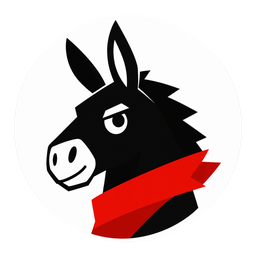
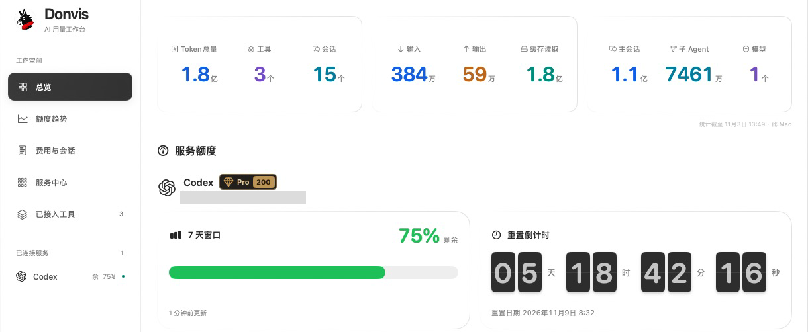
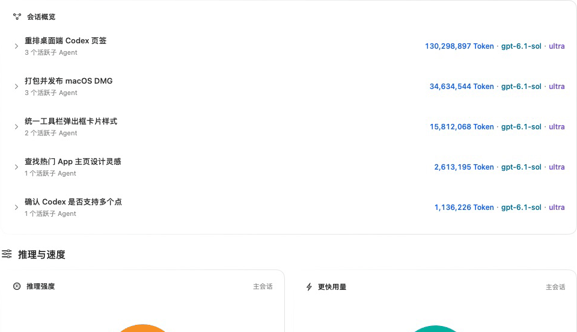
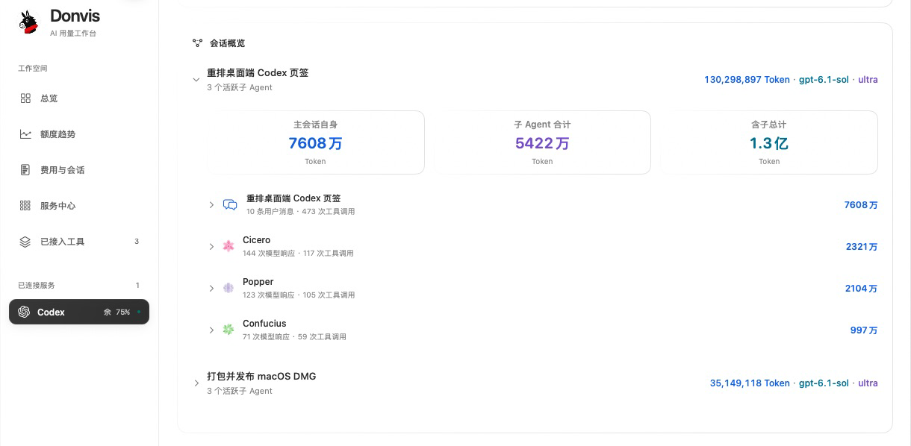
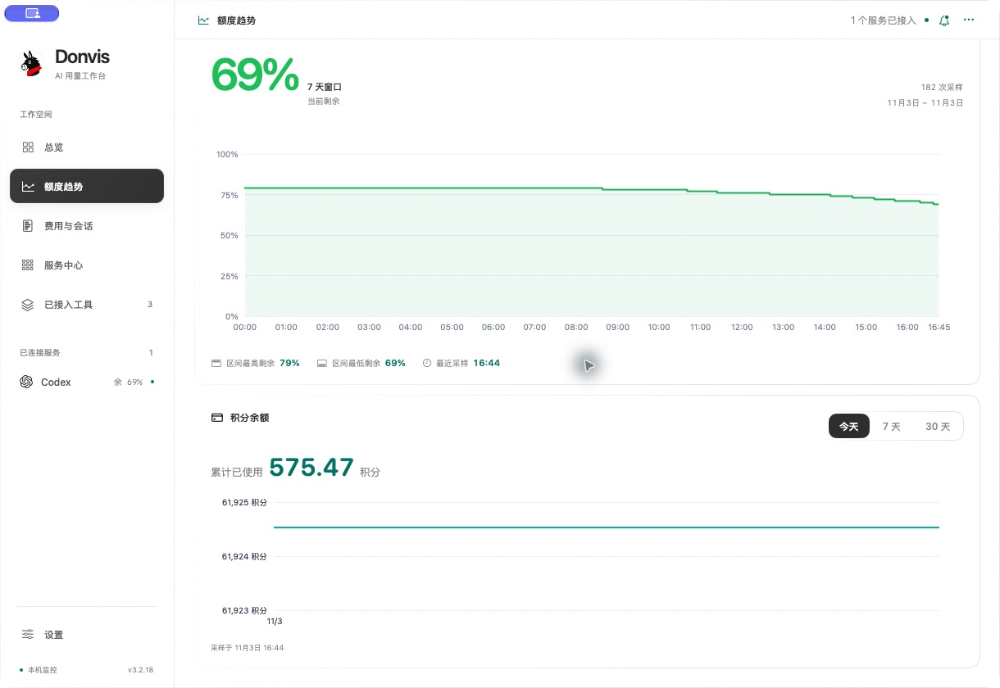
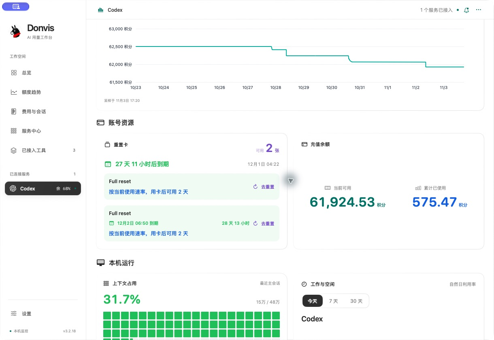
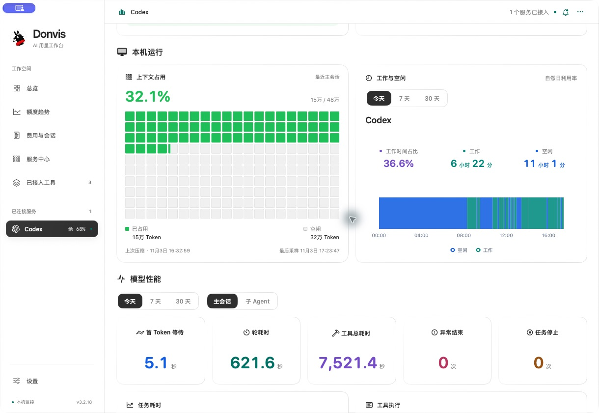
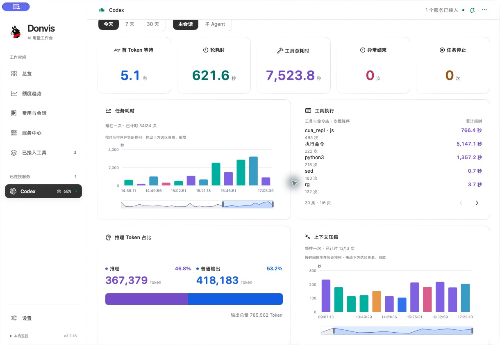
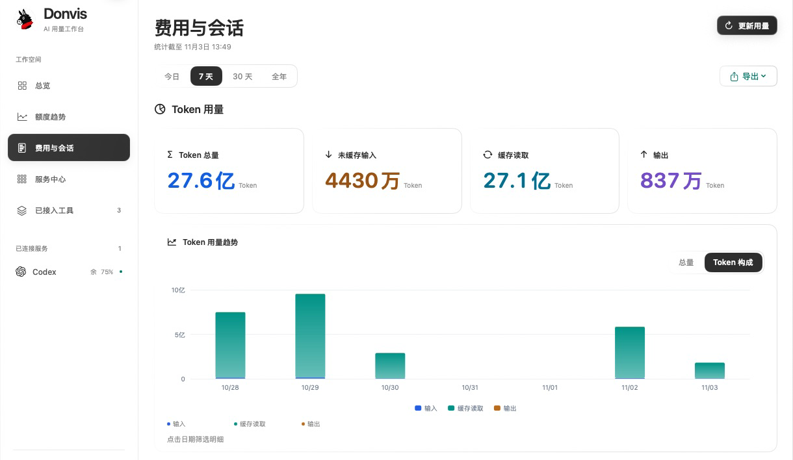
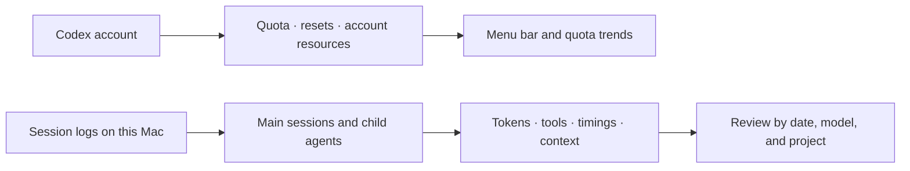

<h1>Donvis · 驴维斯</h1>

<strong>Understand your Codex quota, sessions, and the work your agents are doing.</strong>

Check remaining quota in the menu bar. Explore main sessions and child agents in the workspace. Find high-usage sessions, revisit slow tasks, and plan your next stretch of work without digging through logs.

  <a href="https://github.com/sherlockmen/Donvis/releases/download/v3.2.20/Donvis-3.2.20-macOS-arm64.dmg"><strong>Download for Apple Silicon</strong></a>
  &nbsp;·&nbsp;
  <a href="https://github.com/sherlockmen/Donvis/releases/download/v3.2.20/Donvis-3.2.20-macOS-x86_64.dmg"><strong>Download for Intel</strong></a>

v3.2.20 · macOS 13+ · <a href="https://github.com/sherlockmen/Donvis/releases/tag/v3.2.20">Release notes and checksums</a>

<a href="README.md">简体中文</a> · <strong>English</strong>

**This release focuses on Codex.** Donvis recognizes local records from Codex Desktop, Codex CLI, and the official VS Code extension. Other service integrations are still being tuned and are not included in the supported scope.

## More than a remaining percentage

| What do you want to know? | Where to look in Donvis |
| --- | --- |
| Several agents finished. Which one used the tokens? | [Expand the session family](#expand-a-session-family-down-to-each-agent) to separate the main session, child-agent total, and combined total. |
| How long might my quota last at this pace? | [Check quota trends](#see-what-remains-and-how-long-it-may-last) alongside consumption rate, estimated remaining time, and the next reset. |
| How much context space does this chat have left? | [Read the 200-block capacity view](#200-context-blocks-you-can-read-at-a-glance) and hover for exact token ranges. |
| Why did that task take so long? | [Inspect task and tool timings](#trace-a-slow-task-to-its-records), including first-token wait, context compaction, and recorded tool executions. |
| Which project accounted for today's usage? | [Choose a day in the calendar](#from-a-yearly-calendar-to-a-single-day), then explore its models, projects, and sessions. |
| Prefer to keep the main window closed? | [Stay in the menu bar](#small-details-for-everyday-use) for quota, context, and task status, and open the workspace when needed. |

[Get started](#get-started) · [Interface details](#small-details-for-everyday-use) · [Data and privacy](#data-and-privacy) · [FAQ](#faq)

## Expand a session family, down to each agent

When a task involves several agents, the next useful question is what each one contributed.

- **Three totals make ownership clear:** Main-session usage, child-agent usage, and the combined total appear separately. Expand an individual agent for its token breakdown.
- **Recognizable sessions and agents:** Titles, nicknames, stable avatars, parent agents, models, and reasoning effort help you follow the records without cross-checking IDs.
- **Return to the original chat:** When a valid thread record is available, choose “Open Chat” to open the corresponding Codex session.
- **Explore the same work from different angles:** Switch between today, 7 days, or 30 days; main sessions or child agents; and grouping by model or client. A treemap shows tool calls, with a separate ranking for recognized `SKILL.md` reads.

Inspect uncached input, cache reads, cache writes, output, and reasoning separately. **Reasoning is part of output**, so it is not added to the total a second time. Session relationships and skill reads depend on identifiable local records; a skill-file read is not a complete skill execution.

View the session-family screenshot

## See what remains and how long it may last

Put remaining quota beside the rate of consumption to plan the next stretch of work.

| Now | Over time | Ahead |
| --- | --- | --- |
| Remaining or used percentage, last update | Recorded quota samples, recent consumption rate | Estimated remaining time, exhaustion time, flip-style reset countdown |

**Estimated remaining time tells you roughly how much longer you can keep going**, based on current quota and observed consumption. When a new window has too few samples, Donvis may use the previous window's rate and labels it as a reference. With no valid rate, it waits. The estimate does not include quota from a future reset and is not a guarantee.

The curve distinguishes **scheduled resets, confirmed reset-card use, and quota recovery with an unconfirmed source**. Hover to inspect the supporting record. If an account supplies one quota window, Donvis shows one; clients using the same account share its quota.

View recorded quota and credit-balance history

### Reset cards show more than a count

- **Expiring cards come first:** See each card's expiry date and time remaining, with green, amber, and red emphasis as expiry approaches.
- **A reference before you use one:** With valid consumption samples, estimate how long a full quota might last to help decide when to use a card.
- **Credits and consumption together:** Review the current balance, consumption during the recorded period, and the balance curve in one place.

These resources appear only when the account returns them. “Go to Reset” opens the official page; “I used a reset card” marks local history. Donvis does not use reset cards automatically.

## 200 context blocks you can read at a glance

A percentage can feel abstract. **200 small blocks, each representing 0.5%**, make available capacity easier to see.

The context card shows capacity for the most recent main-session request. Its final occupied block can be partially filled. Hover for the corresponding token range, occupied capacity, and free space. The last sample and most recent compaction times help you judge freshness.

The neighboring **working and idle** view shows when Codex ran tasks. Today uses a timeline; 7-day and 30-day views show utilization by calendar day, with working time, idle time, and their shares.

> Context capacity is not the sum of tokens across all chats. Working time comes from recognized task intervals, with overlapping intervals merged. Unrecorded periods count as idle; these figures do not measure your personal working hours or productivity.

## Trace a slow task to its records

A long task can involve waiting, tool execution, or context compaction. Donvis separates those records so you can investigate further in the charts.

| Start here | What you can inspect |
| --- | --- |
| **First-token wait and turn duration** | The median; hover for P95, valid samples, expected turns, and coverage to judge the evidence behind the number. |
| **Individual task-duration bars** | Records ordered by occurrence. Drag the lower selection to zoom; hover for the session title and an available first-question excerpt. |
| **Tools and command families** | Call counts, cumulative duration from complete timing records, and recent operations, with pagination for more tools. |
| **Context compaction records** | One bar per timed compaction, with the same draggable selection and zoom controls. |
| **Agent task overlap** | Peak active tasks, overlapping time, and its distribution across completed task intervals. |
| **Reasoning and speed settings** | Reasoning versus ordinary output tokens, plus separate duration shares for recognized reasoning effort and faster-usage mode. |

View main sessions and child agents separately. Failures and user interruptions are counted separately too. These views reflect task activity recorded on this Mac: a full turn includes tools and waiting, cumulative parallel tool time differs from elapsed task time, and task overlap does not mean concurrent model requests. Some charts appear only when enough records are available.

## From a yearly calendar to a single day

**Find the pattern, then explore the cause.** Use the annual token-activity calendar to find busy dates and the daily chart to follow changes. Click a date with records to filter the day's token summary and session details; clear the filter to return to the original range.

Switch between totals and composition, then explore models, projects, and sessions. Hover over or open summary metrics for the underlying lists; child-agent entries can show their parent main session.

Export **JSON or CSV** for further analysis. Donvis focuses on tokens by default. The interface shows API reference estimates only after you enable them and enter model prices. Records without prices remain unpriced, and these estimates are not a Codex subscription bill. Exports may use valid saved prices independently of the interface's display setting.

## Small details for everyday use

| Detail | What it does for you |
| --- | --- |
| **A moving task-status icon** | While Codex has active tasks, the menu-bar icon uses different motion for recorded reasoning-effort settings, giving you a quick status cue. |
| **More information in a small space** | A fixed-width menu-bar area holds quota and context. Multiple metrics rotate every 4 seconds; hover for update times, reset times, and exact token values. |
| **A flip-clock countdown** | Days, hours, minutes, and seconds flip individually, keeping the reset time beside the quota without date arithmetic. |
| **Color makes details easier to follow** | Distinct colors separate token categories, models, and reasoning effort; agent avatars help you recognize expanded records. |
| **Analysis data is ready before cards appear** | Data is prepared before the cards are shown; bars and lines then animate into view, with light motion while scrolling. |
| **Glass that follows the system** | Light and dark appearances, rounded corners, and fine borders connect the workspace and menu popup, respecting Reduce Motion and Reduce Transparency. |
| **Out of the way until needed** | Close the main window and keep Donvis in the menu bar. Open trends, usage details, or the workspace from the popup, and configure global shortcuts and low-quota alerts. |

The icon reflects recorded task state and settings; it is not a progress indicator. Motion adapts to accessibility settings, chart type, and data volume. Low-quota alerts require notification permission.

## Get started

1. **Choose your installer.** [Apple Silicon](https://github.com/sherlockmen/Donvis/releases/download/v3.2.20/Donvis-3.2.20-macOS-arm64.dmg) is for M-series Macs; [Intel](https://github.com/sherlockmen/Donvis/releases/download/v3.2.20/Donvis-3.2.20-macOS-x86_64.dmg) is for Intel Macs. Open the DMG and drag `Donvis.app` into Applications.
2. **Use your existing Codex sign-in.** Install and sign in to Codex Desktop or Codex CLI before opening Donvis. Check “Connected Tools” for client detection.
3. **Let real data become ready.** Quota reads need a working sign-in and network access. Local statistics need an initial log scan. Pages show update times, scan progress, and missing-data states.
4. **Make it fit your routine.** Adjust remaining or used quota display, low-quota alerts, and global shortcuts. If you do not need LAN access, turn off the snapshot service under Settings → iPhone & Local Network.

The current installers use an **ad-hoc signature and are not notarized with Apple Developer ID**. If macOS blocks Donvis, verify the download source, then go to System Settings → Privacy & Security and choose “Open Anyway” for Donvis.

The main app requires **macOS 13+**. Both v3.2.19 architectures have passed build and installer checks, and the Intel package passed CLI checks under Rosetta. Testing on physical Intel Macs and macOS 13 remains outstanding. No Windows package is currently available.

## Data and privacy

**Account quota tells you what remains; local logs show how Codex was used.** They come from different sources. Total tokens cannot be directly converted into a subscription-quota percentage.

**Please check the LAN setting:** The snapshot service is currently enabled by default on port `4100`. Devices on the same network can read it without authentication. Snapshots may contain account labels, client information, and the device name. Turn it off under Settings → iPhone & Local Network when you do not need it.

| Data | Source and limits |
| --- | --- |
| Quota, resets, and account resources | Read through Codex app-server using your existing sign-in. Refreshing uses the network, and available fields depend on the account response. |
| Tokens, models, projects, and sessions | Calculated from logs on this Mac, rather than total account usage across all devices. Missing records or format changes can affect coverage. |
| Session details and performance hints | Some details read local session titles and short first-question excerpts to help identify tasks. |
| API reference estimates | Calculated using saved prices. They are not a provider bill and do not incur charges. |
| JSON and CSV | Exclude conversation bodies, account information, and keys, but include project names, models, anonymous session identifiers, and tokens. Check work-related information before sharing. |
| LAN snapshots | Exclude conversation bodies and keys. Account labels and other information may still be visible to devices on the same network. |
| iCloud | The current ad-hoc release does not have iCloud entitlements, so iCloud sync is unavailable. |

## FAQ

**Why is there only one quota window?** Donvis shows what the account returns, without assuming a fixed “5-hour + 7-day” pair.

**Why is there no curve just after launch?** Quota history needs recorded samples, and local statistics need a log scan. Missing or unfinished records do not mean zero usage.

**Why does the account remain after I close Codex?** A client's running state is separate from its account connection. Closing one client does not clear the shared quota.

**Can Donvis control agents or use reset cards automatically?** Donvis currently observes and analyzes. It does not send tasks to Codex, change models, buy quota, or use reset cards for you. “Open Chat” depends on a registered `codex://` handler and a valid local thread record.

## Feedback and license

Please open an [issue](https://github.com/sherlockmen/Donvis/issues) with your Donvis version, macOS version, chip type, and steps to reproduce the problem. Remove account and private work information before posting screenshots or logs.

The images and animation on this page show **real data from this Mac**. Identifying information is redacted; usage values are unchanged.

About the screenshots and animation

All media was captured from the Donvis app already running on this Mac, after its data loaded. No separate app instance or constructed demonstration data was used. The captures were taken in v3.2.18 with the fixes from this release; v3.2.19 changes only the release version number. The animation shows session expansion.

[Download the latest release](https://github.com/sherlockmen/Donvis/releases/latest) · [Release history](https://github.com/sherlockmen/Donvis/releases) · [MIT License](LICENSE)
