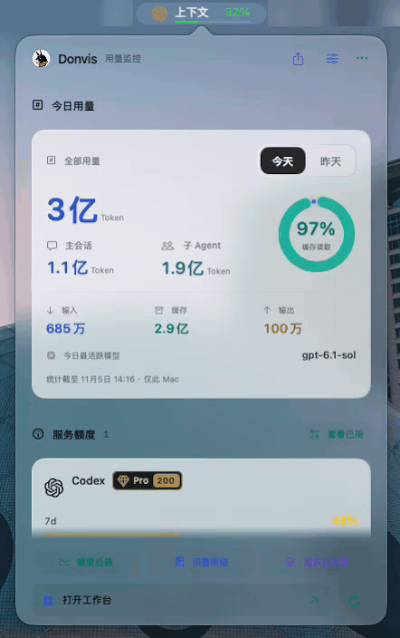
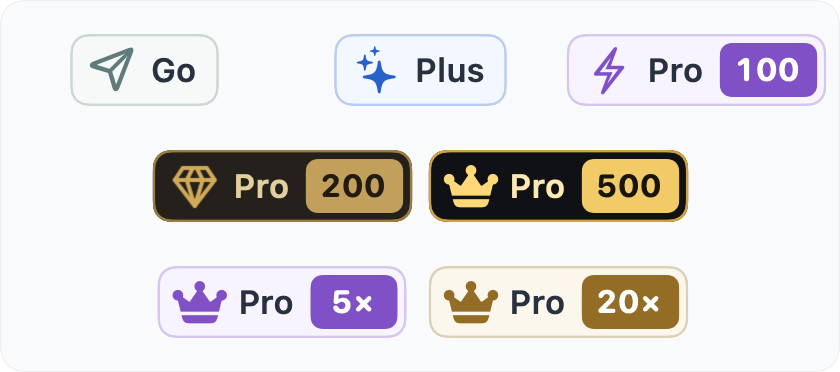
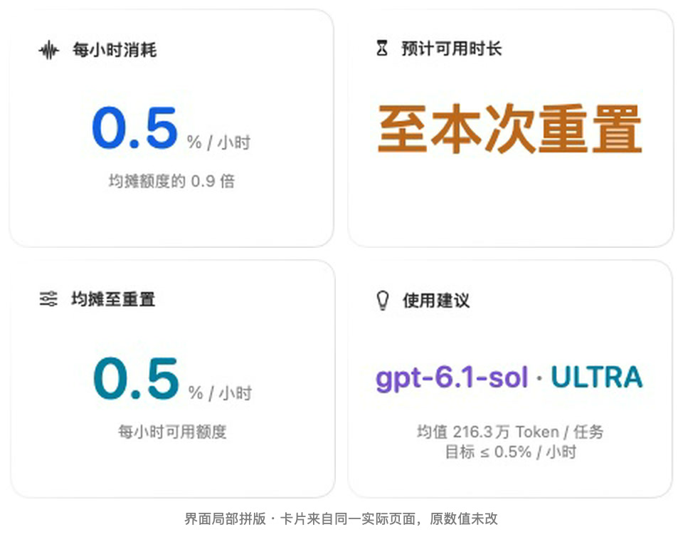
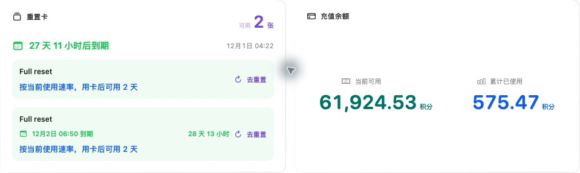
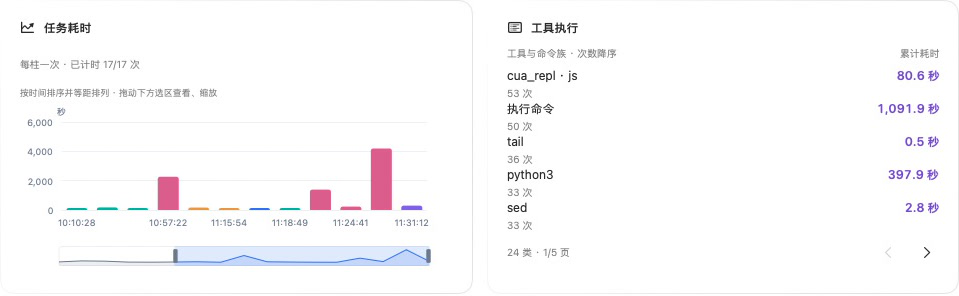
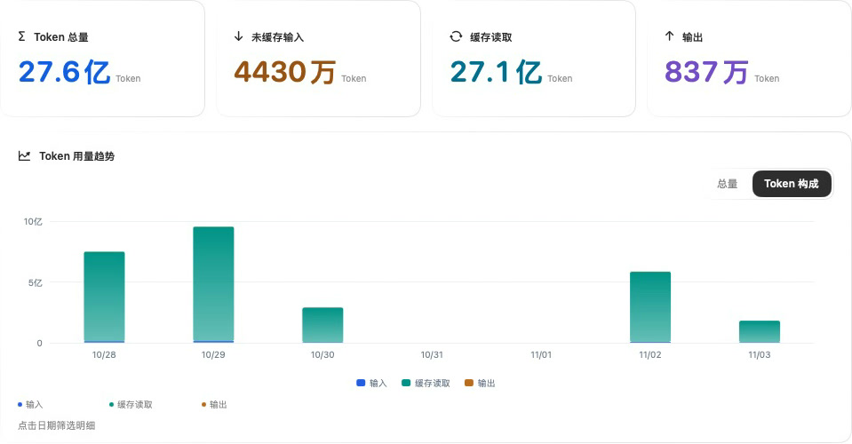
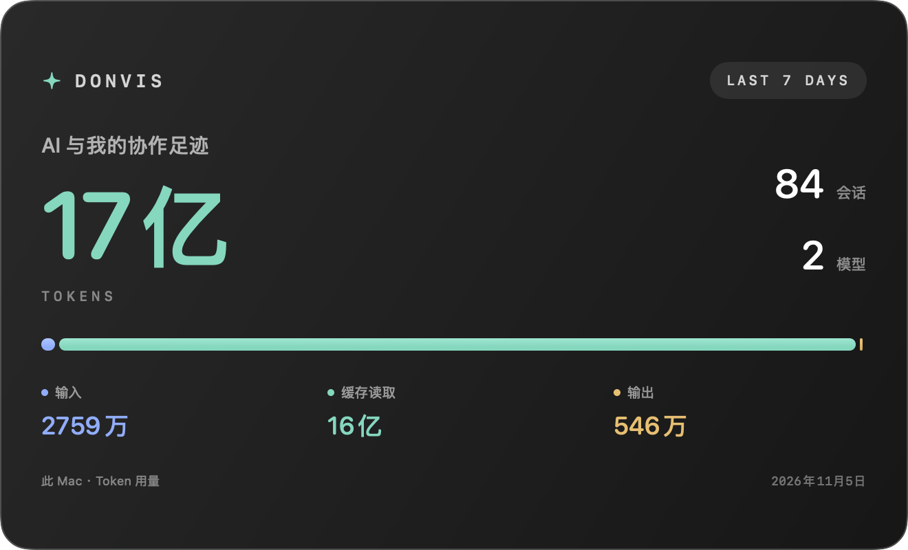

<h1>Donvis · 驴维斯</h1>

<strong>Codex 放手跑，掌控感留在菜单栏。</strong>

还剩多少额度，哪个 Agent 在忙，时间和 Token 花到了哪里。 抬眼看现状，点开追原因，下一段工作更有数。

  <a href="https://github.com/sherlockmen/Donvis/releases/download/v3.2.21/Donvis-3.2.21-macOS-arm64.dmg"><strong>下载 Apple Silicon 版</strong></a>
  &nbsp;·&nbsp;
  <a href="https://github.com/sherlockmen/Donvis/releases/download/v3.2.21/Donvis-3.2.21-macOS-x86_64.dmg"><strong>下载 Intel 版</strong></a>

v3.2.21 · macOS 13+ · 免费下载 · 沿用 Codex 登录

<strong>简体中文</strong> · <a href="README.en.md">English</a>

从菜单栏展开，关心的事就在手边。实机操作节选，保留原速与原数值，身份信息已脱敏。

**为每天都在用 Codex 的 Mac 用户而做。** 读取 Codex Desktop、Codex CLI 与官方 VSCode 扩展的本机记录，无需另外注册 Donvis 账号。当前公开版本聚焦 Codex。

[随手掌握](#一眼看现状点开就够用) · [安排额度](#开跑前先把额度安排好) · [追查消耗与等待](#谁花了-token哪里拖了时间追得到) · [回看使用轨迹](#今天到全年留下看得懂的使用轨迹) · [开始使用](#让-donvis-住进你的菜单栏)

## 一眼看现状，点开就够用

**少切一次窗口，少打断一次思路。** 额度与上下文在菜单栏固定宽度里轮换；悬停再看精确 Token、采样和重置时间。点开就是一个 410 × 650 的小工作区：今日 / 昨日用量、缓存读取占比、模型、主会话与子 Agent、工具与技能、账号资源，继续往下看就有。

**长聊还剩多少空间，也有形状。** 200 格上下文，每格 0.5%；末格按实际比例填充，悬停精确到 Token 区间与已用 / 空闲容量。工作台保留最近采样和压缩时间，让你知道这份读数新不新。

卡片随弹窗连贯展开，中间滚动、头尾固定；点指标进分析，从底部直达趋势和明细。分享、设置、刷新都在手边，看完点外部收起，监控继续。

### 连工作的节奏，都有自己的表情

七档工作动画，从轻缓转动到黑金快节奏，随已识别的主会话强度变化。会员也有自己的辨识度：**Pro 200 黑金宝石、Pro 500 皇冠**，Go、Plus 各有图形，Pro 100 与 5× / 20× 也配有各自的图形和数字牌。

<picture>
  <source media="(prefers-color-scheme: dark)" srcset="assets/showcase-20261105/membership-dark.png">
  
</picture>

按你的桌面习惯使用，还有这些原生细节

- **安静常驻。** 可调大小的原生窗口、标准红黄绿；关闭后继续在菜单栏监控。登录时启动、隐藏 Dock、窗口置顶和自录全局快捷键，自由组合。
- **键盘直达。** ⌘1…⌘5 切工作区页面，总览中 ⌘R 同时刷新账号额度与本机用量，⌘, 开设置。菜单栏可精简，额度可选剩余 / 已用，指标每 4 秒轮换；服务可固定或按 5 / 10 / 30 / 60 秒轮播。
- **图表可以摸索。** 原生浮层显示完整名称和准确值，跨出卡片边缘仍可读；点图例隐藏 / 恢复，拖范围滑块聚焦一段。触控板经过图表依然滚动页面，可交互浮层也能移入继续查看。
- **手感跟着系统。** 胶囊选择器滑动回弹，展开行整行可点，数据就绪后卡片和图表自然进入。玻璃、圆角与明暗外观保持统一，尊重减少动态效果、减少透明度，关键控件和会员提供读屏标签。
- **后台有节奏。** 自动额度刷新随活跃程度调整，锁屏暂停自动额度查询；本机记录后台增量扫描，弹窗收起后卸下隐藏内容。扫描进度、更新时间、缓存标记和可用错误状态帮助判断数据。

动态图标为应用原始资源，非任务进度条；多个活动主会话取最高已识别强度，子 Agent 不单独驱动主图标，Ultra 与 faster usage 分别识别。会员图为生产组件原生渲染，非七个账号截图；标识对应 Codex 账号会员。

上下文来自最近主会话请求，不是全部聊天累计 Token。没有读到样本时显示原因，不以零占用代替未知。

## 开跑前，先把额度安排好

**“还剩多少”旁边，再放上“能用多久”。** 小时消耗、预计可用时长、均摊至重置与使用建议四张卡，把余量变成下一段工作的参考。颜色提示压力，重置时间既能看具体时刻，也能看逐位翻动的倒计时。

界面局部拼版，四张卡来自同一实际页面，原数值未改。

**卡别放到过期才想起来。** 可用数量、逐卡到期日期、剩余时间和用卡后时长参考放在一处；先到期的排前面，临期变色，72 小时 / 24 小时提醒。“去重置”直达官方页面，由你决定是否使用。积分余额与已观测消耗也一起看。

低额度、严重不足、耗尽、确认重置或恢复，各有提醒。今天 / 7 天 / 30 天的额度与积分曲线，让你回看刚才怎样消耗、何时恢复；不必守着一个百分比反复刷新。

从一份读数，到一段有依据的计划

- **以实际账号为准。** 只展示官方返回的额度窗口，剩余 / 已用可切换；更新时间、缓存与可用错误状态保留。卡片明细暂未同步会明确提示，不拿缺失数据冒充零张或已过期。
- **估算有依据。** 悬停看观测时段、采样数与实际下降量；对照消耗 / 均摊节奏倍率，也可参考历史模型与推理强度的完整任务样本。新周期采用历史速度会注明，样本不足先等待。
- **变化有记录。** 曲线区分周期重置、已确认用卡与来源未确认的恢复，支持图例筛选与精确悬停；区间高低点、采样数、最近更新一并保留。积分累计消耗基于本机已保留样本。
- **提醒按窗口判断。** 阈值可调，不同窗口独立评估，同一账号、窗口、周期去重；额度恢复以实际收到的数据确认。需开启并授权系统通知。
- **多账号少来回。** 关联已有登录的 Codex 配置目录，切换额度、上下文与工作记录，或刷新全部账号。移除关联保留原文件；不会改其他 CLI 的登录，本机 Token 历史不按账号完整隔离。

预测按已观测消耗估算，不保证任务完成或准确耗尽时间；不预支未来重置补充额度。Donvis 不自动使用重置卡。额度历史支持 JSON 导出和确认后清除本地记录。

## 谁花了 Token，哪里拖了时间，追得到

**一个总数，展开成整个 Agent 家族。** 主会话自身、子 Agent 合计、含子总计分开呈现；标题、昵称、稳定头像、模型和推理强度帮助认出每个成员，多层委派还能追到上级。

输入、缓存读取、记录中存在的缓存写入、输出和推理逐项可查。发现高消耗会话，搜索标题继续找；有效线程可直接“打开聊天”回到 Codex。工具调用树图、消息构成与技能读取排行，让数字继续解释工作方式。

**等待也有线索。** 首 Token 等待和轮耗时分开看，任务耗时柱追到某一次；工具 / 命令族排行看谁花了时间，压缩记录看上下文何时整理，Agent 并行度看多少会话在同时推进。

继续追到样本、任务和工具

- **主会话与子 Agent 分开分析。** 今天 / 7 天 / 30 天自由切换，会话分析可前后翻时段；主会话看用户消息，子 Agent 看独立模型响应，辅助执行另列。汇总指标可展开会话、Agent、模型与项目名单，列表支持按标题搜索、继续加载。
- **Token 拆得清楚。** 缓存读取与未缓存输入分别呈现，推理是输出的一部分，不重复计入总量；推理 / 普通输出构成、已记录任务的推理强度时长占比与 faster usage 分开查看。
- **数字也交代覆盖。** 首 Token 等待和完整轮耗时摘要基于正常完成样本，悬停查看中位数、P95、有效样本、预期轮数与覆盖率；失败次数、失败率和任务停止分别统计。
- **图上的一根柱，能追到任务。** 当天按发生时间画已计时任务，标题与可读取首问帮助辨认，拖范围滑块缩放；7 天 / 30 天看日总耗时或平均耗时。压缩事件单独计时，多日可看每日压缩耗时占比。
- **工具不止一个名字。** 调用次数、完整计时的累计耗时、命令族、近期主要操作与最近会话线索一起看，分页继续查。模型 / 使用端可比较消息活动，技能排行展示识别到的 SKILL.md 读取请求。
- **并行状态有时间坐标。** 执行中数量、区间峰值、任务重叠时间与分布，主会话和子 Agent分别观察，状态以最后采样为准。

会话归属和计时依赖本机可识别记录。“打开聊天”需有效线程与本机 Codex 协议注册；技能读取不代表完整技能执行。轮耗时包含工具和等待，累计工具耗时可能重叠；任务区间重叠不等于模型请求并发。

## 今天到全年，留下看得懂的使用轨迹

**先看哪天特别忙，再点进去找原因。** 今天看小时变化，7 天 / 30 天看总量与构成，全年看热力日历。点选日期，汇总和会话跟着筛选；模型排行与项目用量继续回答资源花到了哪里。

今天 / 昨日对照，年度 Token、有记录天数、单日峰值、最长任务与连续使用天数，让长期使用有了轮廓。工作 / 空闲时间线把已识别任务串起来，7 天 / 30 天还能回看自然日运行占比。

**想留一张纪念，就生成分享卡。** 今天、7 天或 30 天，复制图片或保存 PNG；Token 汇总与构成、会话数和模型数留下，邮箱、项目名、标题和对话正文不放进去。需要更深入的分析，再导出 CSV / JSON；参考 API 成本也能按自己的单价计算。

自己的使用账本，也留好分析出口

- **从全年来到一天。** 年历可切年份、回当年，选择日期联动用量与会话，清除筛选恢复原范围。累计 Token、当前 / 最长连续使用天数来自此 Mac 已读取记录。
- **换角度看投入。** 模型排行将前五与其他分开，项目 Token 面积图与按会话数的项目分布分别展示；Desktop / CLI / VSCode 的消息活动另可比较。
- **参考成本自己定。** 主动开启 API 估值，为每个模型填写输入、缓存读、缓存写、输出四类单价，缺单价标未计价；与月度参考预算比较。它不是订阅账单，也不会自动限额。
- **导出跟着所选范围。** Token CSV / JSON 可按范围或所选日期保存，不含正文、账号、密钥与完整路径，仍含项目名、模型和匿名会话标识；额度历史 JSON 可能含账号标签。分享卡在本机生成，由你决定是否外发。
- **本机资源也有去向。** 会话、子 Agent、归档、未分类、worktree 与其他文件分项展示磁盘逻辑大小、比例、测量时间与部分读取状态，支持重新统计。客户端单独展示运行状态、驻留内存、进程数和扫描时间，自身探测不冒充你的 CLI 活动。
- **接入与排查有入口。** 服务可显隐排序，目录支持搜索、分类、连接 / 启用 / 待配置筛选、官网和接入说明；其他平台仍在调试。设置可查局域网快照与 iCloud 能力状态，也可导出脱敏诊断 JSON，导出不等于自动上传。

工作时长按已识别任务区间合并计算，空闲包含未观测时段，反映 Codex 活动而非个人工时或效率。磁盘统计与进程内存分别呈现，没有自动清理或释放内存功能。

## 让 Donvis 住进你的菜单栏

1. **下载并安装。** 选择 [Apple Silicon / M 系列](https://github.com/sherlockmen/Donvis/releases/download/v3.2.21/Donvis-3.2.21-macOS-arm64.dmg) 或 [Intel](https://github.com/sherlockmen/Donvis/releases/download/v3.2.21/Donvis-3.2.21-macOS-x86_64.dmg)，打开 DMG，将 `Donvis.app` 拖进“应用程序”。
2. **沿用 Codex 登录。** 先安装并登录 Codex Desktop 或 Codex CLI，再打开 Donvis。“已接入工具”可确认客户端识别。
3. **让第一份数据就位。** 额度需要网络和有效登录；本机统计首次扫描日志，曲线随后积累。调整展示、提醒与快捷键，就能开始。

<strong>下一次让 Codex 放手跑，也让自己看得清。</strong>  <a href="https://github.com/sherlockmen/Donvis/releases/latest"><strong>免费下载 Donvis →</strong></a>

安装兼容、数据与隐私

- **系统与安装包。** 主应用要求 macOS 13+，部分扩展组件要求 macOS 14+。两架构已进行构建与包检查、Rosetta 下的 Intel CLI 检查；尚未完成 Intel 真机和 macOS 13 实机验证。Windows 暂无发布包。
- **签名与云能力。** 当前安装包为 ad-hoc 签名，未经 Apple Developer ID 公证。若 macOS 阻止打开，确认下载来源后，可在“系统设置 → 隐私与安全性”的 Donvis 提示处处理。当前发布包没有 iCloud 权限，不能使用 iCloud 同步。
- **两种数据各司其职。** 账号额度和资源通过 Codex app-server 沿用已有登录联网读取；Token、项目、会话和性能来自此 Mac 日志，不代表账号所有设备。部分详情会临时读取本机会话标题与首问摘要；记录缺失或尚未补齐会影响覆盖。
- **局域网快照当前默认开启。** 监听 4100 端口，同网设备无需认证即可读取，可能包含账号标签、设备名和客户端信息，不含对话正文或密钥。不需要时，在“设置 → iPhone 与局域网”关闭。
- **观察与分析。** Donvis 不替你发任务、切模型或使用重置卡。预测、参考估值和统计记录各有来源，不保证完成任务、节省费用或提升效率。

演示素材说明

应用界面取自运行中的 Donvis，统计数值保留原样，身份信息已去除。工具栏弹出框来自本次实机录屏；其余截图与会话动图复用已发布版本的真实素材，保留拍摄时的日期与数值。七档动画是应用原始资源，会员画廊由生产组件原生渲染，非多个账号截图。

[发行说明](https://github.com/sherlockmen/Donvis/releases/tag/v3.2.21) · [反馈问题](https://github.com/sherlockmen/Donvis/issues) · [历史版本](https://github.com/sherlockmen/Donvis/releases) · [MIT License](LICENSE)
