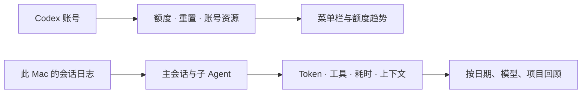

<h1>Donvis · 驴维斯</h1>

<strong>把 Codex 的额度、会话和 Agent 工作过程，看明白。</strong>

菜单栏里掌握余量，工作台里拆开主会话与子 Agent。 不必翻日志，就能找到高消耗会话、回看耗时任务，安排下一段工作。

  <a href="https://github.com/sherlockmen/Donvis/releases/download/v3.2.19/Donvis-3.2.19-macOS-arm64.dmg"><strong>下载 Apple Silicon 版</strong></a>
  &nbsp;·&nbsp;
  <a href="https://github.com/sherlockmen/Donvis/releases/download/v3.2.19/Donvis-3.2.19-macOS-x86_64.dmg"><strong>下载 Intel 版</strong></a>

v3.2.19 · macOS 13+ · <a href="https://github.com/sherlockmen/Donvis/releases/tag/v3.2.19">发行说明与校验值</a>

<strong>简体中文</strong> · <a href="README.en.md">English</a>

**目前聚焦 Codex。** 可识别 Codex Desktop、Codex CLI 与官方 VSCode 扩展的本机记录；其他平台仍在调试，暂不列为已支持。

## 不止看一个剩余百分比

| 想知道什么 | 在 Donvis 里怎么看 |
| --- | --- |
| 多个 Agent 跑完，消耗由谁产生？ | [展开会话家族](#展开会话家族把总量拆到每个-agent)，分开看主会话自身、子 Agent 合计与含子总计。 |
| 按现在的节奏，额度还能用多久？ | [看额度趋势](#额度有多少还要看能用多久)，对照消耗速度、预计可用时长与下次重置。 |
| 这次聊天的上下文还有多少空间？ | [看 200 格容量图](#200-格上下文看得见的容量)，悬停查看精确 Token 区间。 |
| 一次任务为什么耗时这么久？ | [查任务与工具耗时](#慢在哪一次追到具体任务)，看首 Token 等待、上下文压缩和已记录的工具执行。 |
| 今天的用量集中在哪个项目？ | [从日历点进某一天](#从全年日历点进某一天)，继续看模型、项目和会话。 |
| 不想一直开着工作台？ | [留在菜单栏](#藏在日常操作里的小设计)，看额度、上下文与工作状态，需要时再展开。 |

[开始使用](#开始使用) · [界面细节](#藏在日常操作里的小设计) · [数据与隐私](#数据与隐私) · [常见问题](#常见问题)

## 展开会话家族，把总量拆到每个 Agent

一次任务交给多个 Agent，最有用的下一步是看清它们各自做了什么。

- **三份数字，一眼分清归属。** 主会话自身、子 Agent 合计、含子总计分别展示；继续展开某个 Agent，查看它的 Token 明细。
- **会话有标题，Agent 有辨识度。** 昵称、稳定头像、上级 Agent、模型和推理强度放在同一条记录里，减少来回对照。
- **从统计回到原聊天。** 有有效线程记录时，点“打开聊天”返回对应 Codex 会话。
- **换个角度看同一段工作。** 今天 / 7 天 / 30 天、主会话 / 子 Agent、按模型 / 按使用端切换；工具调用用矩形树图展示，识别到的 `SKILL.md` 读取另有排行。

输入、缓存读取、缓存写入、输出与推理分别可查。**推理属于输出的一部分**，不会在总量里再加一遍。会话归属和技能读取以本机可识别记录为准，技能读取次数不等于完整技能执行次数。

展开查看：会话家族静态界面

## 额度有多少，还要看能用多久

把“还剩多少”和“消耗得多快”放在一起，才方便安排下一段任务。

| 看当前 | 看变化 | 看接下来 |
| --- | --- | --- |
| 剩余 / 已用百分比、更新时间 | 实际采样曲线、近期消耗速度 | 预计可用时长、耗尽时间、翻页重置倒计时 |

**预计可用时长直接告诉你大约还能用多久**，按当前余量与已观测消耗估算。新周期样本不足时可能参考上周期速度，界面会标明；没有有效速率时保留等待状态。估算不预支未来重置补充的额度，也不是保证。

曲线上还会区分**周期重置、已确认用卡与来源未确认的额度恢复**，悬停查看记录依据。账号只返回一个额度窗口，就只展示一个；同一账号的不同客户端共用一份额度。

展开查看：真实额度曲线与积分余额记录

### 重置卡不只显示“还有几张”

- **先到期的排前面。** 每张卡都能看到到期日期和剩余时间；临近到期从绿色转为黄色、红色。
- **用之前有个参考。** 有有效消耗样本时，估算恢复完整额度后大约能用多久，帮助判断何时用卡。
- **积分与消耗放在一起。** 同一处查看当前余额、已记录期间的消耗与余额曲线。

这些资源只在账号实际返回时出现。“去重置”打开官方页面；“我已使用重置卡”用于标记本地历史。Donvis 不会自动消耗重置卡。

## 200 格上下文，看得见的容量

一个百分比很抽象，**200 个小方块，每格 0.5%**，让剩余空间更容易感知。

上下文卡片展示最近主会话请求的容量，已占用区域的末格可以部分填充；悬停看对应的 Token 区间、已占用和空闲容量。下方保留最后采样与最近压缩时间，方便判断数据是否新鲜。

旁边的**工作与空闲**回答另一件事：Codex 今天在哪些时段运行任务。今天看时间线，7 天 / 30 天看自然日利用率；工作时长、空闲时长和占比一起呈现。

> 上下文不是所有聊天的累计 Token。工作时长来自已识别任务区间，重叠区间合并；未记录时段会计入空闲，不代表你的投入工时或工作效率。

## 慢在哪一次，追到具体任务

长任务的耗时可能来自等待、工具执行或上下文压缩。Donvis 把这些记录拆开，让你沿着图表继续查。

| 从哪里入手 | 能继续看到什么 |
| --- | --- |
| **首 Token 等待与轮耗时** | 中位数；悬停看 P95、有效样本、预期轮数与覆盖率，判断数字有多少依据。 |
| **每次任务的耗时柱** | 按发生时间排序；拖动下方选区缩放，悬停查看会话标题和可读取的首问摘要。 |
| **工具与命令族排行** | 调用次数、完整计时的累计耗时、近期主要操作；分页查看不同工具。 |
| **上下文压缩记录** | 每柱一次已计时压缩，同样可以拖动选区查看与缩放。 |
| **Agent 并行度** | 已结束任务中的峰值活跃数量、任务重叠时间和分布。 |
| **推理与速度档** | 推理 Token / 普通输出的构成；另以时长占比观察已识别推理强度与“更快用量”。 |

主会话与子 Agent 可以分开看，失败与主动中断也分别统计。这里反映本机日志中的任务过程：完整轮耗时包含工具与等待，并行工具的累计耗时不等于任务经过的实际时长；任务重叠不等于模型请求并发。部分图表在记录足够时才出现。

## 从全年日历，点进某一天

**先看分布，再找原因。** 年度 Token 活动日历找高用量日期，每日用量图看变化；点击有记录的日期，联动当天 Token 汇总与会话明细，清除筛选即可回到原范围。

总量与构成可以切换，模型、项目和会话可以继续展开；悬停或点开汇总指标，查看具体名单，子 Agent 还能追到所属主会话。

需要另做分析时导出 **JSON / CSV**。默认关注 Token；主动开启 API 参考估值并填写模型单价后，界面才显示估算金额。缺少单价的记录保持未计价，参考估值不是 Codex 订阅账单。导出可能使用已保存的有效单价，与界面显示开关分别处理。

## 藏在日常操作里的小设计

| 细节 | 用起来是什么感觉 |
| --- | --- |
| **工作状态会动** | Codex 有活动任务时，菜单栏图标按已记录的推理强度呈现不同动效，抬眼就能留意工作状态。 |
| **小空间轮流展示** | 菜单栏固定宽度容纳额度与上下文；多个指标每 4 秒轮播，悬停再看更新时间、重置时间和精确 Token。 |
| **倒计时像翻页钟** | 天、时、分、秒逐位翻动；额度与重置时间放在一起，不必自己算日期。 |
| **颜色帮你认数字** | Token 构成保持清晰的色彩区分，模型与推理强度也有色标；Agent 头像帮助辨认展开后的多条记录。 |
| **先备好内容，再出现** | 分析数据先就位，再呈现卡片；柱形与折线随后自然展开，滚动时保留轻量动效。 |
| **玻璃感跟着系统走** | 明暗外观、圆角和细描边统一工作台与菜单弹窗；尊重系统“减少动态效果”和“减少透明度”。 |
| **平时收起来，需要再展开** | 关闭主窗口后继续留在菜单栏；从弹窗直达趋势、用量明细或工作台，也可设置全局快捷键与低额度提醒。 |

图标反映日志中的任务状态与设置，不是进度条。动画会因系统辅助功能设置、图表类型与数据量调整；低额度提醒需要通知授权。

## 开始使用

1. **选对安装包。** [Apple Silicon](https://github.com/sherlockmen/Donvis/releases/download/v3.2.19/Donvis-3.2.19-macOS-arm64.dmg) 适用于 M 系列 Mac；[Intel](https://github.com/sherlockmen/Donvis/releases/download/v3.2.19/Donvis-3.2.19-macOS-x86_64.dmg) 适用于 Intel Mac。打开 DMG，把 `Donvis.app` 拖入“应用程序”。
2. **使用已有 Codex 登录。** 先安装并登录 Codex Desktop 或 Codex CLI，再打开 Donvis；“已接入工具”查看客户端识别情况。
3. **等真实数据就绪。** 额度读取需要网络和可用登录；本机统计首次需要扫描日志。页面会显示更新时间、扫描进度和缺失状态。
4. **按你的习惯设置。** 调整剩余 / 已用展示、低额度提醒与全局快捷键。无需局域网访问时，在“设置 → iPhone 与局域网”关闭快照服务。

当前安装包使用 **ad-hoc 签名，未经 Apple Developer ID 公证**。若 macOS 阻止打开，确认下载来源后，到“系统设置 → 隐私与安全性”的 Donvis 提示处选择“仍要打开”。

主应用要求 **macOS 13+**。v3.2.19 已完成两架构构建与安装包检查，Intel 包通过 Rosetta 下的 CLI 检查；尚未完成 Intel 真机和 macOS 13 实机验证。Windows 暂无发布包。

## 数据与隐私

**账号额度回答“还剩多少”，本机日志回答“怎样使用”。** 两者来源不同，Token 总量不能直接换算成订阅额度百分比。

**局域网功能请留意：** 当前默认开启快照服务，监听 `4100` 端口，同一网络设备无需认证即可读取。快照可能包含账号标签、客户端信息与设备名；不需要时请在“设置 → iPhone 与局域网”关闭。

| 数据 | 来源与边界 |
| --- | --- |
| 额度、重置与账号资源 | 通过 Codex app-server 使用已有登录读取；刷新会联网，展示字段取决于账号返回。 |
| Token、模型、项目与会话 | 从此 Mac 日志建立统计，不代表账号所有设备的总用量；记录缺失或格式变化会影响覆盖。 |
| 会话详情与性能提示 | 部分详情读取本机会话标题、首问摘要，用于辨认任务。 |
| API 参考费用 | 使用你保存的单价计算，不是服务商账单，也不会产生扣费。 |
| JSON / CSV | 不含对话正文、账号或密钥，但含项目名、模型、匿名会话标识与 Token；分享前检查工作信息。 |
| 局域网快照 | 不含对话正文与密钥；账号标签等信息仍可能暴露给同网段访问者。 |
| iCloud | 当前 ad-hoc 发布包不具备 iCloud 权限，不能使用 iCloud 同步。 |

## 常见问题

**为什么只有一个额度窗口？** 依账号实际返回展示，不强制假设“5 小时 + 7 天”双窗口。

**为什么刚打开没有曲线？** 额度趋势需要积累采样，本机统计需要扫描已有日志。未记录或未完成不代表零用量。

**关闭 Codex 后，为什么账号还在？** 客户端运行状态和账号接入状态不同；退出某个客户端不会清空共享额度。

**能控制 Agent 或自动用卡吗？** 当前用于观察和分析，不会替你向 Codex 发送任务、切换模型、购买额度或使用重置卡。“打开聊天”依赖本机 Codex 的 `codex://` 注册与有效线程记录。

## 反馈与许可

欢迎提交 [Issue](https://github.com/sherlockmen/Donvis/issues)，附上 Donvis 版本、macOS 版本、芯片类型和复现步骤。公开截图或日志前，移除账号与私人工作信息。

本页图片与动图展示**真实本机数据**，身份信息已遮盖，统计数值保持原样。

查看演示素材说明

素材均取自原本运行的本机 Donvis，等待数据加载后截取，未另起实例或构造展示数据。拍摄版本为 v3.2.18（含本轮修复），v3.2.19 仅升级发布版本号。动图展示会话展开交互。

[下载最新版本](https://github.com/sherlockmen/Donvis/releases/latest) · [历史版本](https://github.com/sherlockmen/Donvis/releases) · [MIT License](LICENSE)
