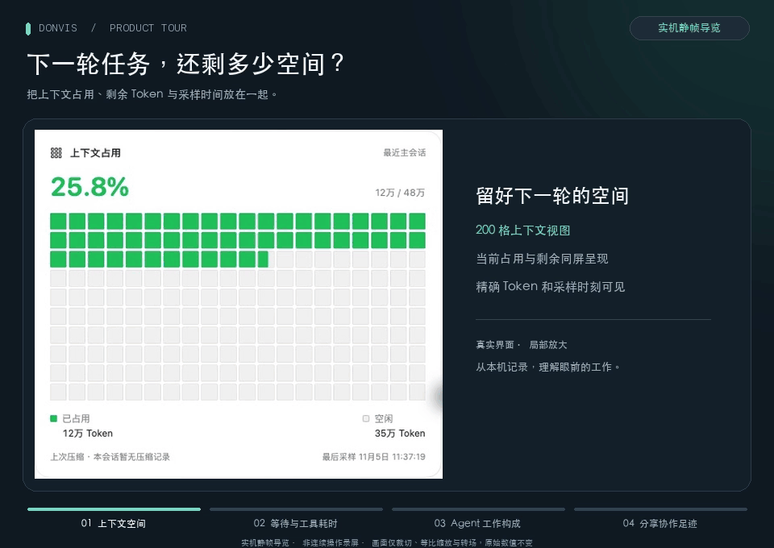
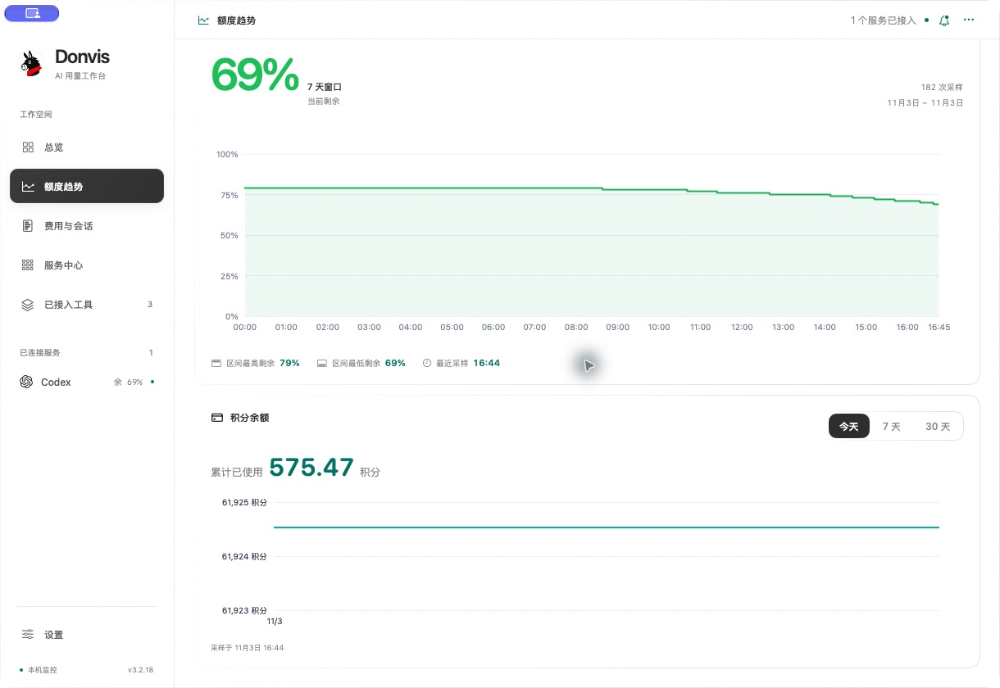
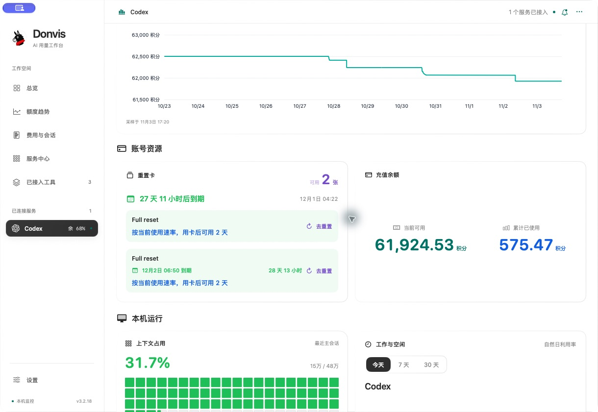
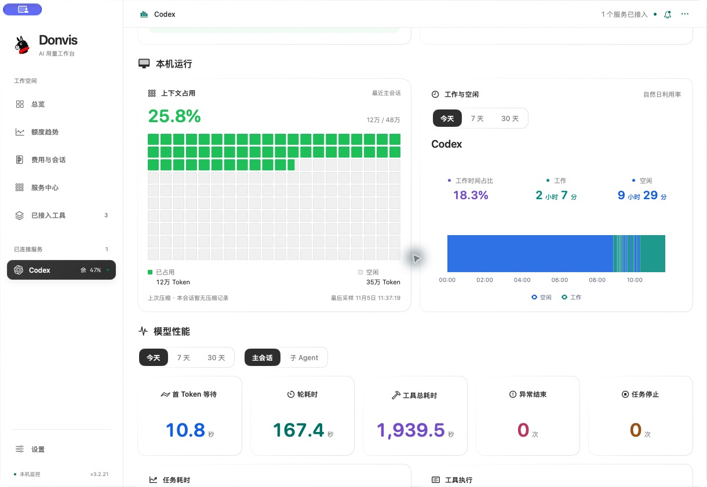
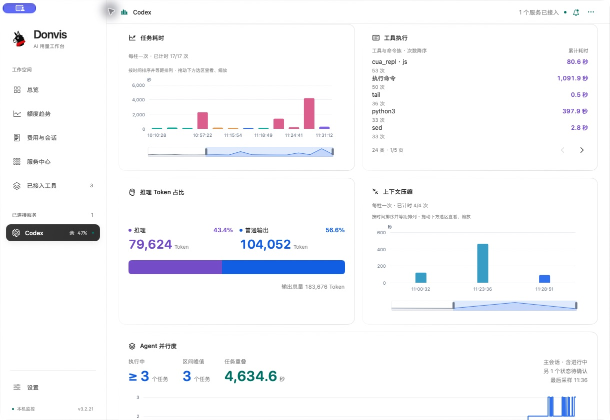
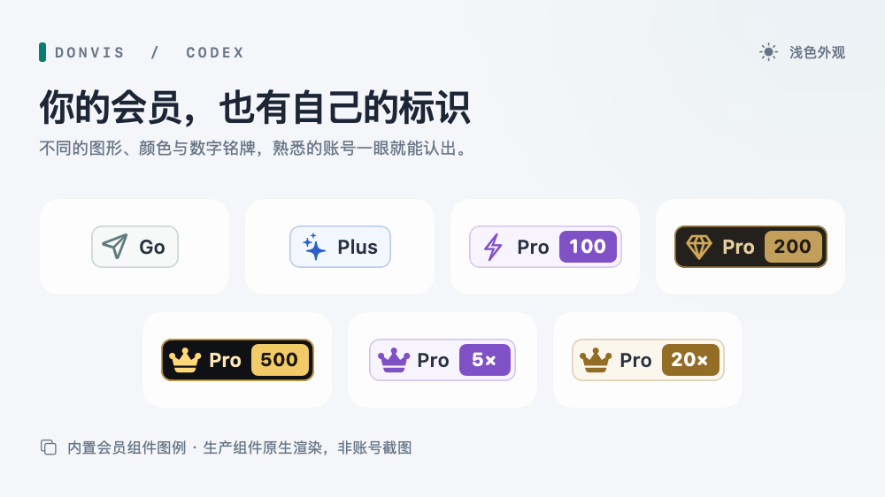

<h1>Donvis · 驴维斯</h1>

<strong>Codex 放手跑，心里始终有数。</strong>

还剩多少额度，哪个 Agent 在忙，时间和 Token 花到了哪里。 抬眼看菜单栏，点开看全局，让每一段 Codex 工作都看得见。

  <a href="https://github.com/sherlockmen/Donvis/releases/download/v3.2.21/Donvis-3.2.21-macOS-arm64.dmg"><strong>下载 Apple Silicon 版</strong></a>
  &nbsp;·&nbsp;
  <a href="https://github.com/sherlockmen/Donvis/releases/download/v3.2.21/Donvis-3.2.21-macOS-x86_64.dmg"><strong>下载 Intel 版</strong></a>

v3.2.21 · macOS 13+ · 免费下载 · <a href="https://github.com/sherlockmen/Donvis/releases/tag/v3.2.21">发行说明</a>

<strong>简体中文</strong> · <a href="README.en.md">English</a>

14 秒看看 Donvis。真实应用静帧剪辑，非连续操作录屏，统计数值保留原样。

**给每天都在用 Codex 的 Mac 用户。** 支持读取 Codex Desktop、Codex CLI 与官方 VSCode 扩展的本机记录，沿用已有登录，无需另外注册 Donvis 账号。当前公开版本聚焦 Codex。

[菜单栏的小工作区](#抬眼知道它在忙点开就是小工作区) · [额度安排](#下一段任务能不能放心开跑) · [Agent 家族](#一个任务一群-agent每一份消耗都有归属) · [性能复盘](#等了很久终于知道时间花在哪里) · [立即开始](#让-donvis-住进你的菜单栏)

[200 格上下文](#200-格把上下文变成看得见的空间) · [全年使用轨迹](#一年的使用轨迹也能点进某一天) · [分享卡](#把这段成果变成一张想分享的卡片) · [会员标识](#你的会员也有自己的标识) · [Mac 原生细节](#顺手的-mac-工具细节也要顺手)

## 抬眼知道它在忙，点开就是小工作区

**不必为了看一眼状态，打断手头的事。** Donvis 常驻菜单栏：工作时图标转起来，额度与上下文在固定宽度里每 4 秒轮换；悬停补上精确 Token、采样时间与重置时刻。喜欢清爽，可以开启精简模式；习惯看已用，也能切换。

### 连工作的节奏，都有自己的表情

<table>
<tr>
<td align="center"> <strong>Low / 默认</strong> 从容起步</td>
<td align="center"> <strong>Medium</strong> 蓝色节拍</td>
<td align="center"> <strong>High</strong> 紫色加速</td>
</tr>
<tr>
<td align="center"> <strong>XHigh</strong> 橙色跃动</td>
<td align="center"> <strong>Max</strong> 粉色疾转</td>
<td align="center"> <strong>Ultra</strong> 金色高档</td>
</tr>
<tr>
<td align="center" colspan="3"> <strong>Ultra + faster usage</strong> 黑金快节奏</td>
</tr>
</table>

七档均为应用实际使用的动画资源，此处放大展示。多个活动主会话取最高已识别强度；子 Agent 不单独驱动主图标。Ultra 与 faster usage 分别识别，图标不是任务进度条。

### 一点展开，把关心的事收进 410 × 650

菜单栏弹出框有完整的小工作区：**额度、重置倒计时、消耗节奏、上下文、今日 / 昨日 Token、缓存读取占比和模型用量**，随手就能看。主会话与子 Agent 活动、工具与技能、重置卡与积分资源，也能在里面继续展开。

打开时，卡片随弹窗连贯展开；固定顶部和底部，中间独立滚动，翻到底也不用找入口。点用量指标进入对应分析，从底部直达趋势、明细或服务账号；分享、设置和刷新就在手边。看完点外部收起，监控继续。

## 下一段任务，能不能放心开跑？

只知道“还剩 30%”，很难决定接下来做什么。Donvis 把**余量、速度、预计可用时长与重置时间**放在一起，让你有依据地安排任务。

- **现在有多少。** 按账号实际返回展示额度窗口，剩余 / 已用自由切换；颜色提示压力，重置时间可看具体时刻，也可用翻页钟逐位显示天、时、分、秒。
- **按这个节奏能跑多久。** 小时消耗、预计可用时长、均摊至重置与使用建议，四张卡一起参考；消耗与均摊节奏的倍率、历史模型与强度的试用参考也能对照，悬停查看观测时段与样本依据。
- **刚才发生了什么。** 今天 / 7 天 / 30 天的额度与积分曲线，区分周期重置、已确认用卡和来源未确认的恢复；区间高低点、采样数与最近更新都有记录，图例可隐藏曲线，悬停看准确值。
- **重要时刻有人提醒。** 低额度、严重不足、耗尽、确认重置或恢复分别提示；阈值可调，不同窗口独立判断，同一周期去重。重置卡临近 72 小时 / 24 小时到期也会提醒。

看看真实额度与积分曲线

时长与节奏来自已观测消耗，并非保证；新周期引用历史速度时会注明，样本不足时保留等待状态。提醒需要系统通知授权，重置恢复以实际读到的数据为准。

### 重置卡，别等快过期才想起来

**几张可用、哪张先到期、值不值得现在用，一处看清。** 卡片按到期时间排列，同时显示日期和剩余时间；临近到期变色。有足够消耗样本，还会给出恢复完整额度后的可用时长参考。积分余额、已观测消耗与历史曲线在旁边，账号资源不用再分散着找。

“去重置”直达官方页面，由你决定是否使用。卡片明细暂未同步会明确提示，不拿缺失数据冒充零张或已过期。

## 一个任务，一群 Agent，每一份消耗都有归属

并行交给多个 Agent 很爽，跑完只剩一个总数却不够。**在 Donvis，展开一条主会话，就能看见整个 Agent 家族。**

- **主会话自身、子 Agent 合计、含子总计，三份数字分开看。** 多层 Agent 还能追到上级，避免把团队总量误认成主会话自己的消耗。
- **认得出每一个成员。** 会话标题、Agent 昵称、稳定头像、模型与推理强度一起出现；悬停汇总指标还能打开对应名单，沿归属继续追查。
- **拆到每一类 Token。** 输入、缓存读取、记录中存在的缓存写入、输出和推理各有位置；推理属于输出，不会重复相加。
- **看完统计，回到现场。** 搜索会话标题、继续加载更多记录；有效线程可直接“打开聊天”返回 Codex。辅助执行与交互会话分别呈现。

想比较主会话和子 Agent，切换范围就行。主会话看用户消息，子 Agent 看独立模型响应；前后翻查时段，模型、使用端、消息构成、工具调用矩形树图与技能读取排行，让“用了多少”继续回答“怎么用的”。

会话归属以本机可识别记录为准；技能排行统计识别到的 SKILL.md 读取，不代表完整技能执行次数。“打开聊天”依赖本机 Codex 的协议注册。

## 200 格，把上下文变成看得见的空间

长聊到哪里了，还能放多少内容？**每格 0.5%，200 格拼出当前上下文容量。** 最后一格可部分填充，颜色随占用变化，悬停精确到 Token 区间、已占用与剩余容量。

最后采样、最近确认的压缩时间一起保留，数字的新鲜程度也有交代。旁边的**工作与空闲**把已识别任务画成时间线：今天看什么时候忙，7 天 / 30 天看每天的运行占比，多个任务重叠时只计一份经过时间。

上下文来自最近主会话请求，不是全部聊天累计 Token。空闲包含未观测时段，这里记录 Codex 任务活动，不衡量个人工时或效率。

## 等了很久，终于知道时间花在哪里

**是首字等得久，某个工具拖住了，还是上下文在压缩？** 从概览到具体任务，Donvis 留下可继续追的线索。

| 想追的线索 | 继续往下看 |
| --- | --- |
| **多久开始回应** | 正常完成样本的首 Token 等待、完整轮耗时中位数；悬停看 P95、有效样本、预期轮数与覆盖率。 |
| **哪次任务特别长** | 每次任务按发生时间画柱，标题与可读取的首问摘要帮助辨认；拖动范围滑块聚焦一段。7 天 / 30 天可看日汇总与平均耗时。 |
| **哪个工具花了时间** | 工具和命令族的调用次数、已完整计时的累计耗时、近期主要操作；分页继续看。 |
| **什么时候压缩了上下文** | 一次事件一根柱，保留计时依据，同样支持范围缩放；7 天 / 30 天还可看每天压缩耗时占比。 |
| **几个会话同时在跑** | 执行中数量、区间峰值、任务重叠时间与时间分布；主会话和子 Agent 分开观察。 |
| **强度和速度档怎么用的** | 推理 / 普通输出 Token 构成、各推理强度的已记录任务时长占比，单独展示 faster usage。 |

失败次数、失败率和任务停止分别统计，样本覆盖也摆在数字旁边。长耗时有证据，缺失记录有说明。

完整轮耗时包含工具与等待；累计工具耗时可能重叠。并行度统计任务活动区间，包含采样时仍执行的任务，不等于模型请求并发，状态以最后采样为准。

## 一年的使用轨迹，也能点进某一天

**先看全年热力日历，再点进最忙的那一天。** 今天看小时变化，7 天 / 30 天看趋势，全年看热力日历、年度 Token 与有记录天数；切换年份、回到当年，点击日期联动汇总与会话，清除筛选回到原范围。

高用量来自哪个项目、哪个模型？模型排行把前五与其他分开，项目用量面积图和会话分布换角度对照；Desktop / CLI / VSCode 的消息活动另可比较。今日 / 昨日一眼对照，累计 Token、单日峰值、最长任务、当前与最长连续使用天数，让长期记录有了轮廓。

**想换算成 API 参考成本，也由你决定。** 主动开启估值，为模型填写输入、缓存读、缓存写、输出单价，再与月度参考预算比较；缺单价会标记未计价。需要自己分析，可按所选范围与日期导出 CSV / JSON。

参考成本不是订阅账单，参考预算不会自动限额；金额按保存的单价计算。官方额度、本机 Token 与参考估值分别展示。

## 把这段成果，变成一张想分享的卡片

选今天、7 天或 30 天，**复制图片，或存成 PNG。** 卡片在本机生成，展示 Token 汇总与构成、会话数和模型数，不放邮箱、项目名、会话标题或对话正文。是否分享、发给谁，由你决定。

## 你的会员，也有自己的标识

Go、Plus、Pro 100 / 200 / 500、Pro 5× / 20×，各有颜色、图形和数字牌。**Pro 200 的黑金宝石、Pro 500 的皇冠，小小一枚也认真设计。** 工作台与弹出框各有适配尺寸，浅色、深色都清楚，读屏也能读出完整会员名称。

<picture>
  <source media="(prefers-color-scheme: dark)" srcset="assets/v3.2.21/membership-dark.png">
  
</picture>

上图由应用生产组件原生渲染，展示内置样式，非七个账号截图。标识对应 Codex 账号会员，Donvis 不售卖这些订阅。

## 顺手的 Mac 工具，细节也要顺手

**放在菜单栏里安静待着，需要时一键叫出来。** 可调大小的原生窗口、标准红黄绿、关闭后继续监控；登录时启动、隐藏 Dock、窗口置顶与自录全局快捷键，按你的桌面习惯选择。

**能看，也能摸索。** 图表悬停显示完整名称与准确数值，浮层跨出卡片边缘仍可读；点图例隐藏 / 恢复，拖滑块放大一段，触控板经过图表依然顺畅滚动页面。胶囊选择器有滑动回弹，展开行可整行点，卡片与图表在数据就绪后自然进入。

**明暗外观之外，也照顾不同使用方式。** 玻璃层次、圆角、描边统一到弹出框；尊重系统减少动态效果、减少透明度，关键按钮、图表与会员提供读屏标签。

| 还有这些小事 | 少一次来回，多一份清楚 |
| --- | --- |
| **键盘直达** | ⌘1…⌘5 切换工作区页面，⌘R 刷新，⌘, 打开设置；全局显示 / 隐藏快捷键自己录制。 |
| **多个账号目录** | 关联已有登录的 Codex 配置目录，切换额度、上下文与工作记录，刷新所有账号；移除关联保留原文件。本机 Token 历史不按账号完整隔离。 |
| **客户端也看得见** | 识别 Desktop、CLI、官方 VSCode 扩展，查看运行状态、进程数、驻留内存与最近扫描时间；自身探测不冒充你的 CLI 活动。 |
| **磁盘占用有去向** | 会话、子 Agent、归档、未分类、worktree 与其他文件分项展示逻辑大小、比例与测量时间，随时重算；与进程内存分开。 |
| **入口按习惯整理** | 服务显隐、排序、固定或按 5 / 10 / 30 / 60 秒轮播；服务中心可搜索、分类、按连接 / 启用 / 待配置筛选，并查看官网与接入说明。其他平台仍在调试。 |
| **后台有自己的节奏** | 额度自动刷新随活跃程度调整，锁屏暂停自动额度查询；本机记录增量扫描，收起弹窗后卸下隐藏内容。展示扫描进度、更新时间、缓存标记与可用的读取错误状态。 |
| **记录拿得走，问题查得到** | Token CSV / JSON、额度历史 JSON 与脱敏诊断导出；额度本地历史支持确认后清除。局域网快照与 iCloud 能力状态在设置可查。 |

## 让 Donvis 住进你的菜单栏

1. **下载并安装。** [Apple Silicon / M 系列](https://github.com/sherlockmen/Donvis/releases/download/v3.2.21/Donvis-3.2.21-macOS-arm64.dmg) 或 [Intel](https://github.com/sherlockmen/Donvis/releases/download/v3.2.21/Donvis-3.2.21-macOS-x86_64.dmg)，打开 DMG，将 `Donvis.app` 拖进“应用程序”。
2. **沿用 Codex 登录。** 先安装并登录 Codex Desktop 或 Codex CLI，再打开 Donvis。“已接入工具”能确认客户端是否识别。
3. **等第一份数据到位。** 额度需要网络与有效登录；本机统计首次扫描日志，曲线随后积累。按习惯调整展示、提醒和快捷键，即可开始。

<strong>下一次让 Codex 放手跑，也让自己看得清。</strong>  <a href="https://github.com/sherlockmen/Donvis/releases/latest"><strong>免费下载 Donvis →</strong></a>

安装与兼容说明

主应用要求 macOS 13+，部分扩展组件要求 macOS 14+。提供 Apple Silicon / Intel 安装包；已进行两架构构建与包检查、Rosetta 下的 Intel CLI 检查，尚未完成 Intel 真机与 macOS 13 实机验证。Windows 暂无发布包。

当前安装包为 ad-hoc 签名，未经 Apple Developer ID 公证。若 macOS 阻止打开，确认下载来源后，可在“系统设置 → 隐私与安全性”的 Donvis 提示处处理。当前发布包不具备 iCloud 权限，不能使用 iCloud 同步。

数据、隐私与统计边界

- **官方额度与本机记录各司其职。** 通过 Codex app-server 沿用已有登录联网读取额度与账号资源；Token、项目、会话与性能从此 Mac 日志建立，不代表账号所有设备。一个额度窗口就显示一个，不强制凑双窗口。未记录、未返回与零用量分别处理。
- **局域网快照当前默认开启。** 监听 4100 端口，同一网络设备无需认证即可读取，可能包含账号标签、设备名与客户端信息，不含对话正文或密钥。不需要时请在“设置 → iPhone 与局域网”关闭。
- **导出前可自行检查。** Token CSV / JSON 不含正文、账号或密钥，仍包含项目名、模型与匿名会话标识；额度历史 JSON 可能含账号标签。分享卡只保留汇总数据，诊断导出不等于自动上传。
- **记录多少，解释多少。** 性能指标依赖可识别且有计时的日志；部分详情会读取本机会话标题、首问摘要。预算只是参考比较，工具 / 技能次数并非完整行为审计。Donvis 观察与分析，不替你发任务、切模型或消耗重置卡。

演示素材来自哪里

首屏导览来自 v3.2.21 实际运行应用的静帧剪辑；上下文、性能图与分享卡也取自本轮实机。会话展开动图、用量和账号资源图沿用 v3.2.18 / v3.2.19 实机素材。身份信息已去除，统计数值未改写。七档动画是应用原始资源；会员画廊为生产组件的原生渲染，已单独标注。

[反馈问题](https://github.com/sherlockmen/Donvis/issues) · [历史版本](https://github.com/sherlockmen/Donvis/releases) · [MIT License](LICENSE)
