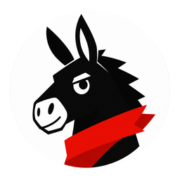
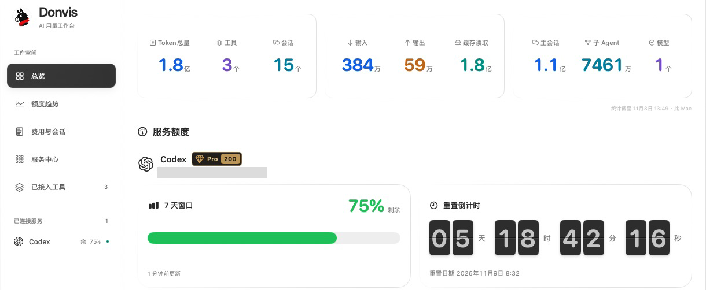
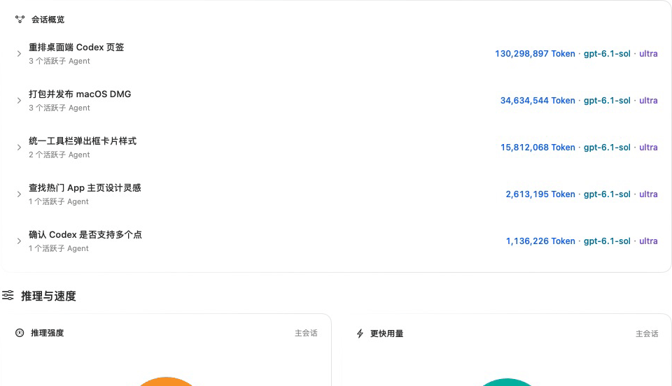
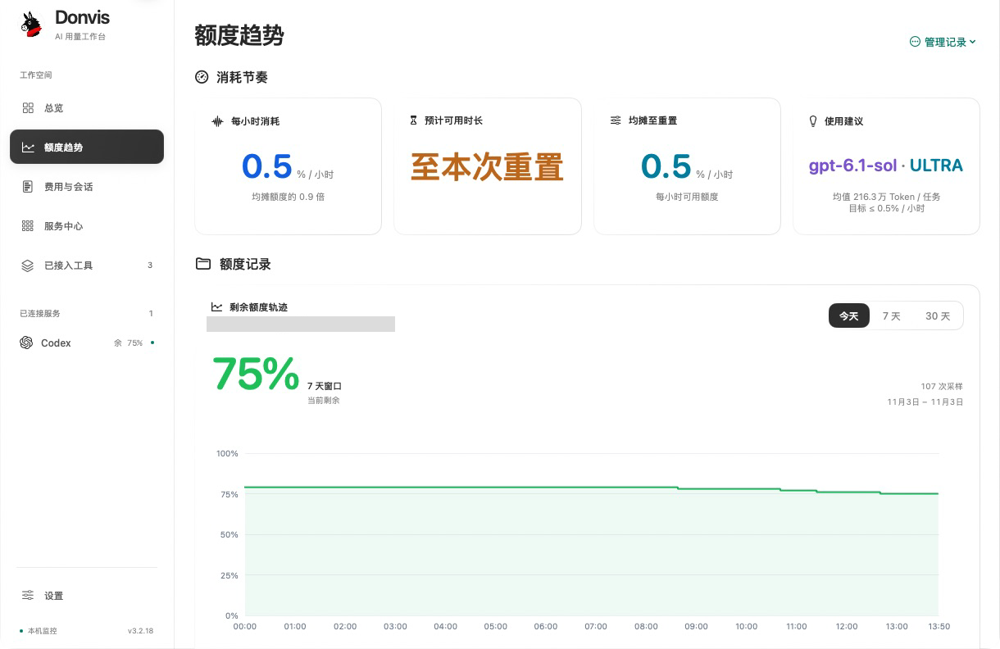
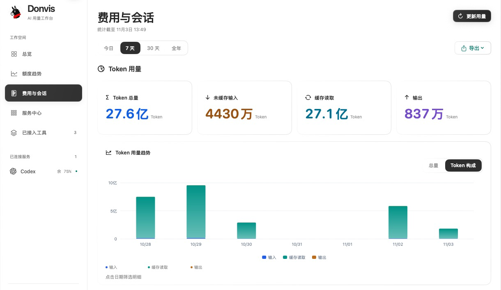
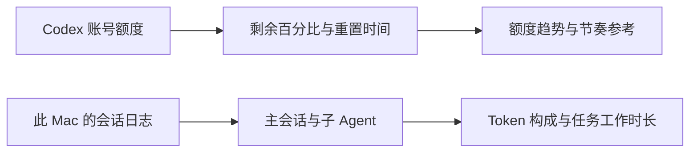

<h1>Donvis · 驴维斯</h1>

<strong>看清 Codex 额度，跟上每个 Agent 的工作。</strong>

在菜单栏看剩余额度，在桌面工作台看会话、子 Agent 和 Token 去向。 从开工前的额度检查，到收工后的用量回顾，都有迹可循。

  <a href="https://github.com/sherlockmen/Donvis/releases/download/v3.2.19/Donvis-3.2.19-macOS-arm64.dmg"><strong>下载 Apple Silicon 版</strong></a>
  &nbsp;·&nbsp;
  <a href="https://github.com/sherlockmen/Donvis/releases/download/v3.2.19/Donvis-3.2.19-macOS-x86_64.dmg"><strong>下载 Intel 版</strong></a>

v3.2.19 · macOS 13+ · <a href="https://github.com/sherlockmen/Donvis/releases/tag/v3.2.19">发行说明与校验值</a>

<strong>简体中文</strong> · <a href="README.en.md">English</a>

> 本页截图与动图来自本机正在运行的 Donvis，等待数据加载后截取。仅遮盖身份信息，统计数值保持原样，反映截取时的本机记录；账号资源按服务实际返回的内容显示。

[开始使用](#开始使用) · [功能预览](#功能预览) · [数据与隐私](#数据与隐私) · [常见问题](#常见问题)

## 开工前、执行中、收工后，都能看清

- **开工前，看额度能否跟上计划：** 查看剩余百分比、重置时间和最近更新时间；同一账号的多个客户端共享一份额度，不重复计算。
- **执行中，看主会话和子 Agent 的分工：** 分开查看模型、推理强度、工具、识别到的 Skill 读取记录与 Token 构成，展开会话了解消耗发生在哪里。
- **任务结束后，看这次工作用了多少：** 按日期、模型、项目和会话回顾本机记录，区分输入、输出与缓存读取，导出 JSON 或 CSV。
- **连续使用时，看消耗节奏：** 对照额度曲线、近期消耗速度与重置时间，结合已有样本调整使用安排。
- **回顾任务的运行分布：** 用工作时长日历和日志中的性能记录观察任务运行，区分主会话自身与子 Agent 的消耗。

当前版本的支持说明与使用展示聚焦 **Codex**。其他服务接入仍在调试，暂不作为已支持能力推荐。

## 开始使用

1. **安装 Donvis。** 下载与你的 Mac 芯片对应的 DMG，打开后将 `Donvis.app` 拖入“应用程序”。
2. **登录原有 Codex 客户端。** 安装并登录 Codex Desktop 或 Codex CLI，再启动 Donvis。已接入工具页可查看 Codex Desktop、Codex CLI 和官方 VSCode 扩展的识别情况。
3. **先看总览，再按需展开。** 菜单栏查看额度，主窗口查看详细统计；在设置中调整低额度提醒、显示方式和全局快捷键。

**首次打开：** 当前安装包使用 ad-hoc 签名，未经 Apple Developer ID 公证。如果 macOS 阻止打开，请前往“系统设置 → 隐私与安全性”，在 Donvis 提示处选择“仍要打开”。仅在确认下载来源后操作。

**首次连接：** 额度读取需要可用的 Codex 登录状态和网络。本机统计需要扫描已有日志；空白、未完成或旧数据会显示相应提示，不代表用量为零。账号未返回的额度窗口不会被补成固定的“5 小时 / 7 天”。

## 功能预览

### 菜单栏里的额度检查

写代码时，无需一直打开完整工作台。点击菜单栏即可查看额度、重置倒计时和数据新鲜度，也可以切换剩余/已用展示。低额度提醒帮助你在中断之前留意消耗；阈值可在设置中调整，通知需要系统授权。

需要完整分析时，从菜单栏或 Dock 打开主窗口。关闭窗口后，Donvis 继续在菜单栏运行；退出应用才会停止监控与提醒。

### 看懂主会话与子 Agent 的消耗

[查看完整静态界面](assets/v3.2.18/codex-sessions.png)

一次任务拆给多个 Agent 后，总 Token 并不能解释全部过程。Donvis 分开呈现主会话与子 Agent，支持按时间范围查看模型、使用端、工具和识别到的 Skill 读取记录，再展开具体会话查看明细。

- 查看会话使用的模型与推理强度，辨认不同配置的工作记录。
- 区分未缓存输入、缓存读取、缓存写入与输出；推理 Token 属于输出的一部分，不会再次相加。
- 区分主会话自身与子 Agent 合计，避免把共享或派生记录误当成多份独立消耗。

Codex 详情还集中展示最近主会话的上下文占用、工作时长日历和日志中的性能记录。工作时长按可识别任务的运行区间统计，并行主会话合并重叠区间，不代表人的投入工时。耗时可能包含工具执行与等待，用于理解自己的工作过程。

### 看额度曲线，也看重置前的节奏

“还剩 40%”和“按现在的节奏能用多久”是两件事。趋势页把实际采样、近期消耗速度、预计可用时长与重置时间放在一起，帮助你决定继续当前安排，还是调整任务节奏。

历史仅来自已经记录的采样。样本不足、窗口重置或记录断档时，预测会受到限制；模型与推理强度的比较也需要足够的已完成任务。建议是基于本机记录的参考，其他设备、任务难度和缓存命中都会影响实际消耗。

服务返回相关资源时，账号资源卡片还会展示余额、积分、重置卡数量与到期时间。“去重置”打开官方页面，“我已使用重置卡”标记本地历史；Donvis 不会替你消耗重置卡。

### 从总 Token，追到具体会话

今天的消耗集中在哪个项目，哪个模型的缓存读取更多，哪些会话占了大头，都可以从本机统计继续展开。日期筛选、活动日历和会话明细让回顾与导出保持同一范围。

**费用按需显示。** 默认以 Token 和会话统计为主；主动开启 API 参考估值并填写模型单价后，界面才会显示估算金额。导出文件仍可能按已保存的有效单价包含参考估值，与界面显示开关分别处理。缺少单价的记录保持未计价，估算不等于 Codex 订阅账单或实际扣费。

JSON / CSV 导出便于另做分析。导出文件包含项目名、模型、匿名会话标识与 Token 等统计字段，分享之前请检查内容。

## 数据与隐私

账号额度回答“还剩多少”，本机记录回答“怎样使用”。Token 总量不能直接换算成订阅额度百分比。

不同信息有不同来源，使用前可以据此决定开启哪些功能：

| 信息 | 来源与边界 |
| --- | --- |
| 账号额度、重置时间、账号资源 | 通过 Codex app-server 读取服务返回的数据；需要原有登录状态，刷新会联网。具体字段取决于账号实际返回内容。 |
| Token、模型、项目与会话统计 | 从此 Mac 的本地日志建立统计，不代表账号在所有设备上的总用量。记录缺失、扫描未完成或格式变化都会影响覆盖范围。 |
| 会话详情与性能记录 | 部分详情会读取本机会话标题或首问用于辨认任务。 |
| API 参考费用 | 使用你保存的模型单价计算；不是服务商账单，也不会因此产生扣费。 |
| JSON / CSV 导出 | 统计导出不含对话正文、账号和密钥，但包含项目名等工作信息。 |
| 局域网快照 | 当前版本默认开启，监听 `4100` 端口。同一网络的设备无需认证即可读取快照；可能包含账号标签、客户端信息与设备名，不含对话正文和密钥。无需此功能时，请在“设置 → iPhone 与局域网”关闭。 |
| iCloud | 当前发布的 ad-hoc 安装包不具备 iCloud 权限，不能使用 iCloud 同步。 |

## 常见问题

**为什么只看到一个额度窗口？**

Donvis 按账号实际返回的窗口展示。有些账号只返回一个周期，窗口时长也不一定固定为 5 小时或 7 天。

**为什么关闭 Codex 客户端后，账号仍然显示？**

客户端是否运行和账号是否仍已接入是不同状态。同一账号的多个客户端共享额度，退出某个客户端不会增加或清空这份额度。

**为什么刚打开没有完整曲线或统计？**

额度趋势需要逐步积累采样；本机统计需要扫描已有日志。请留意页面的更新时间、扫描进度和缺失记录说明。

**可以自动切换模型、控制 Agent 或购买额度吗？**

当前版本用于观察和分析；不会替你切换外部客户端的模型、发送任务、购买额度或使用重置卡。

**支持哪些 Mac？**

主应用要求 macOS 13 或更高版本，提供 Apple Silicon 和 Intel 两个独立安装包。3.2.18 已完成两架构构建与安装包检查，Intel 包另通过 Rosetta 下的 CLI 检查；尚未完成 Intel 真机和 macOS 13 实机验证。Windows 暂无发布包。

## 反馈与许可

遇到问题或有功能建议，欢迎提交 [Issue](https://github.com/sherlockmen/Donvis/issues)。请附上 Donvis 版本、macOS 版本、芯片类型和复现步骤；公开截图或日志前，先移除账号与私人工作信息。

[下载最新版本](https://github.com/sherlockmen/Donvis/releases/latest) · [查看历史版本](https://github.com/sherlockmen/Donvis/releases) · [MIT License](LICENSE)
